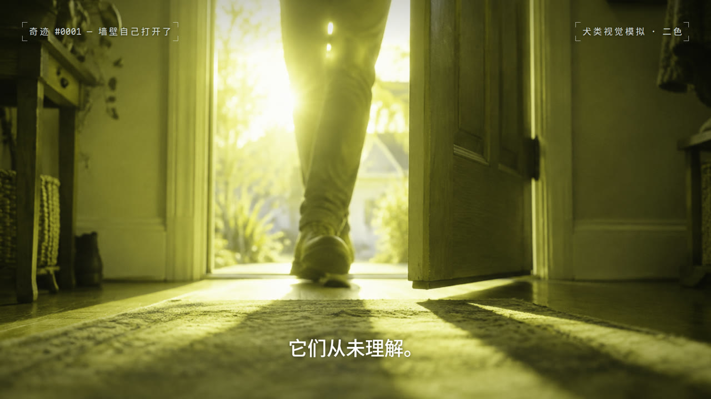
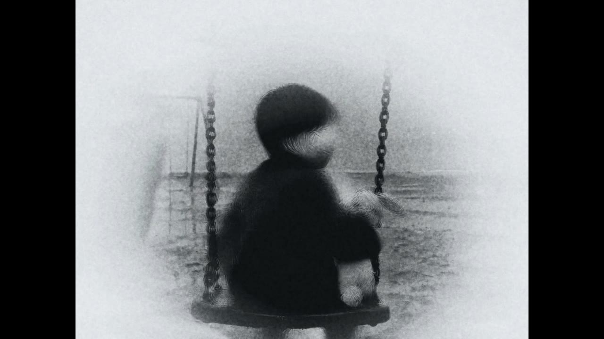
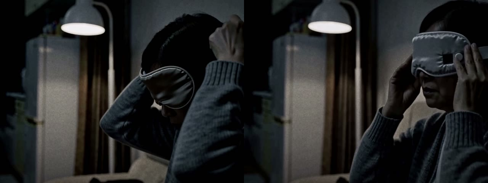
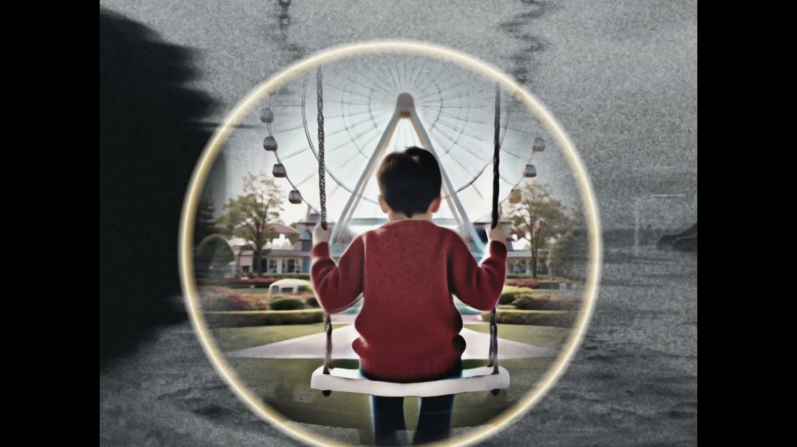
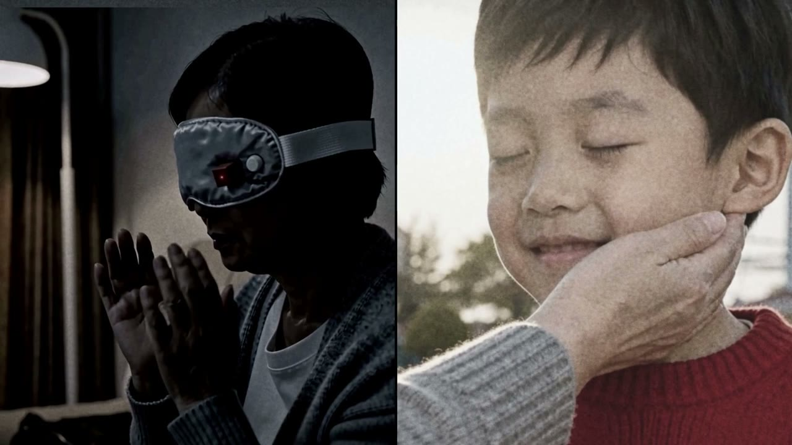
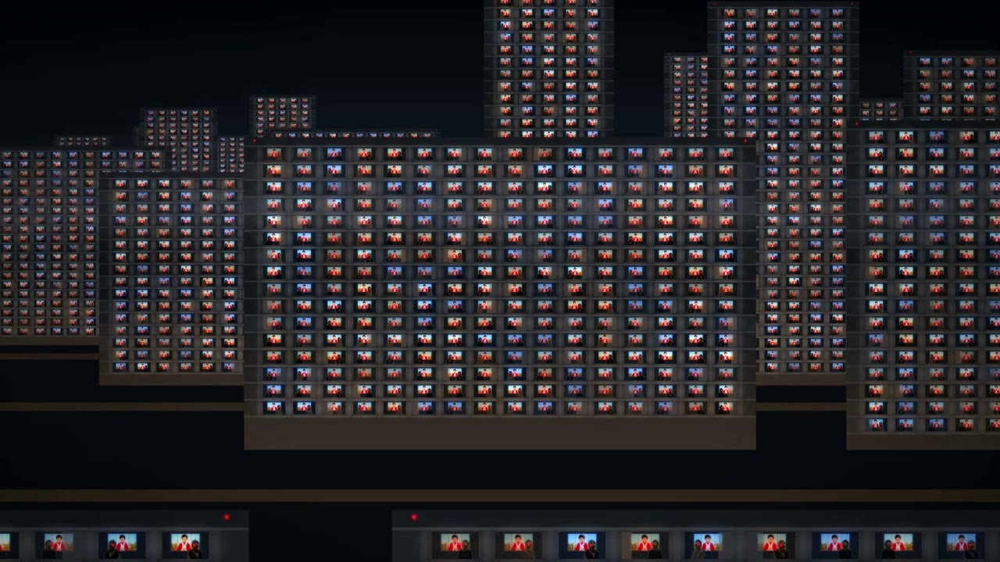

### 从 30 秒到 5 分钟：和 AI 一起做两部科幻短片

扩散模型画一张图，是从一片噪声出发，一步步去噪，比如走 20 步。走到第 3 步时，画面上刚刚有了轮廓：能看出是个孩子坐在秋千上，但脸还没有画出来。

我的第二部 AI 短片就是从这个画面出发的。一位母亲失去了儿子，她对他的记忆，只够画到第 3 步。

这篇文章记下我参加一个 AI 短片比赛时做的两部片子：初赛的 30 秒《驯化计划》，和复赛的 5 分钟《第 3 步的背影》。两部片子的剧本、提示词和代码都由 Claude Opus 5.5编写，画面由视频生成模型生成；我做的是导演的事：定方向、做取舍、挑毛病。

成片：[成片链接]

---

## 一、初赛：一天做完的《驯化计划》

初赛的灵感来自 X 上的一句话：对狗而言，奇点两万年前就已经发生了。它们被一种自己无法理解的智能照料至今。

于是我做了一支「来自未来的广告」。前半段用狗的二色视觉看世界：门自己打开，食物从天而降，疼痛在白色房间里消失。每一件都是奇迹，画面温暖，字幕冷静。最后画面一转，原来这是超级智能公司投放给人类的广告：「十亿只狗都说好。现在，轮到你了。」

这部片子从第一张图到最后一次提交，大约用了一天。流程在这一天里换了一次：最开始是用图像模型出 7 张静帧，用代码做 2.5D 视差，让画面「假装在动」；几个小时后换成了本地部署的 MiniMax H3 图生视频，以静帧为首帧，生成真正的运动。效果立刻不一样了。

也留下了一个教训：视频素材是 24 fps，我直接按 30 fps 的时间线播放，每 4 帧就有一帧重复，看起来一顿一顿的。复赛的时间线从一开始就定成了 24 fps。

回头看，《驯化计划》是在**用 AI 讲一个关于 AI 的故事**：AI 是题材，画面里的 AI 生成只是手段，换成实拍或 CG，故事一样成立。

到了复赛，我想反过来：**让 AI 的工作原理本身，成为讲故事的方式**。

---

## 二、复赛：五天里的七次转向

复赛的片子是 5 分钟。从定下第一版计划到最后一次提交，前后大约五天。这五天里方案改了七次，每次都不是小修小补。

### 1. 选题：为什么不是《盲区里的蓝》

复赛有两个备选题。另一个叫《盲区里的蓝》：一个女孩想要一个不能被删除的证据，系统从头到尾都是对的，她仍然做了那件事。它有一套很漂亮的视觉规则：全片只有屏、窗、天三种光源，而且光源的数量越来越少；还有一个意象，系统回答她「天空为什么是蓝的」，答案完全正确，但那不是她想问的。

两个题目放在一张表里逐项比较：情感上，丧子比认识论更普世；高潮上，「拔掉模块」是一个看得见的动作，比「放下本子」有力；视觉上，《第 3 步》有众数墙和噪声崩塌，单拿一个镜头出来就能当预告片。《盲区》也有赢的地方：它的系统更强大，因为「它是对的」。

真正让我做出抉择的是表里最后一行：**把 AI 换掉，这个故事还成立吗？**

《盲区》换成任何一个算法系统都能讲。《第 3 步》不行：「记忆只够画到第 3 步」这句话，离开了扩散模型谈就没有意义。同时，《盲区》很容易沦为普通的反乌托邦样板戏，如果要脱离此窠臼又容易表现得过于压抑，《第 3 步》相对来说稳得多。

### 2. 第一版计划：「第 3 步」还只是个比喻

第一版计划里，「第 3 步」借的是图生图的「重绘强度」：强度 0.10、30 步，等于从第 3 步开始重画。原始记忆是 Step 3/30，被补全的记忆是 Step 8 到 25。

这是一个好用的比喻，但画面本身和步数没有关系：「第 3 步」的样子靠调色和模糊来演。

### 3. v2：每个镜头看起来都不错，接起来有问题

照计划做出的第一版成片，单看每个镜头都不错，接在一起就露馅了：每个镜头是独立生成的，剪辑点前后人物的位置、衣服、道具对不上。先试着逐镜修补，很快发现补不完。

### 4. v3：推倒重来

v3 从零设计，不再以已有素材为前提。依据是三份AI评审意见，和对四部参考片的逐镜拉片。主线收成一句话：她为了再碰到他，插上了补全模块；最后又亲手拔掉。

### 5. v4.1：先让观众爱上一个不标准的孩子

v3 成片出来后，诊断出 8 个问题，最要命的一条是：母子关系太单薄。观众还没来得及喜欢这个孩子，机器就开始「修正」他了，修正就不疼。

v4.1 把主线改成：**先让观众爱上一个不标准的孩子，再让机器来修正他。**于是有了四音游戏：她哼三个上行的音，他故意把第四个音唱错，扭过身来看她笑。这个错，后来成了全片最重要的东西。

### 6. 方向 B：「第 3 步」变成真的

故事定了，还剩风格。当时有两个方向。

**方向 C** 借用 Chris Marker 的《堤》：她的记忆只有几十张第 3 步的静帧，补全模块做的事，是让它们动起来。「照片记得瞬间，声音记得时间；补全伪造的，是瞬间与瞬间之间的那几秒。」

**方向 B** 是：她走进的不是录像，而是模型的潜空间。他是这幅画里唯一落了墨的地方，其余是还没想起来的留白；补全，就是把留白画满。

我选了 B。原因很简单：C 里的「第 3 步」仍然是用静帧去模仿；B 里的「第 3 步」可以是真的。H3 是扩散模型，它在采样的每一步都会对最终画面做一次预测。只要在生成时把第 1、2、3 步的预测导出来，就能直接看到「模型画到第 3 步」是什么样子。

镜片上的刻度从 30 格改成 20 格，和采样步数一一对应。从这里开始，比喻变成了事实。

### 7. 第五轮：一件眼罩，一只手

方案定了，最后一轮是逐帧挑毛病。AI 生成最难的不是单个镜头好不好看，而是同一件东西在不同镜头里是不是同一件东西。

**0:25 的眼罩。**母亲在沙发上戴上眼罩。原来的镜头里，拿在手上时是带插槽和白旋钮的厚垫，套上头的过程中却变成了一片普通的薄丝绸眼罩，绑带也从白色变成黑色，和后面插槽特写里的道具对不上。我让 AI 改了构图：让插槽那一侧朝向镜头，动作简化成「一次从头顶套下」，重新生成 8 个种子挑了一条。从拿起到戴好，始终是同一件眼罩。

**3:35 的那只手。**母亲在补全世界里伸手去碰儿子，手停在一寸之外；切回现实，她的右手悬在半空。原意是这只手慢慢转向眼罩，去拔模块。可生成出来的画面里，手落到了右脸颊上，看起来像捂脸。问题出在方向：模块在她左太阳穴，手却去了另一边。第一轮重新生成 6 个种子，全部不合格：手掌都是从眼罩下方托上去的，还是像捂脸。第二轮换了路线，让手先抬到额头的高度，再从上方落到模块上，才过关。

同一轮里还修了两处：0:16 的茶几上莫名出现了两个盒子；以及刻度从 8 走到 20，画面却看不出「越陷越深」，于是让补全的调色跟着步数分档，8 步还带着记录的灰和颗粒，20 步饱和得过了头。

整个过程中，我还用 AI 代理做了「盲测」：只给它们每 2 秒一帧的接触表，和一张写着时间、声音、逐字文字但不写含义的表，让它们回答 6 个叙事问题，看片子不靠解释能不能讲清楚，并让它们给出切实的改进建议。当然AI无法代替人类的视听感受，我对Demo片的修改意见仍然是最终裁决。

---

## 三、怎么做到的

### 步数场：把三步拼成一张画

单独导出第 3 步的预测，整幅画面是均匀的模糊。可记忆不是这样的：她记得最清楚的是他，和他身边那一小圈。

所以原始记录的每一帧，都是把同一次生成的第 1、2、3 步预测，按离他远近一圈圈拼起来：中心第 3 步，往外第 2 步、第 1 步，最外面洗成留白。片子里的「模糊」，是模型真正还没画完的样子，不是滤镜。

### 世界从他身上长出来

她插上补全模块的那一刻，用的是同一条生成的不同中间步：以他为中心，一圈第 7 步的彩色世界在灰色的记录里扩开，外面再包一圈第 4 步。刚插上时，补全的世界也还没画完。

后来她想把刻度往下拽，世界就从画框边缘退回留白，只剩他。这一段用的是同一条生成的第 11、7、3 步。她的手被抬回去，刻度弹回顶端，世界一下子又长回来。

### 他的脸溶进噪声

她拔掉模块后，补全的他要消失。我们把他的脸部特写编码进 H3 的视频潜空间，做真实的前向加噪，再解码出来，四档噪声交叉溶解。他的笑脸是被真正的噪声一点点吃掉的。

### 用四个音讲完一段关系

全片没有旁白，只有两句台词。贯穿始终的是四个音：她哼三个，他接第四个。

- 记忆里，他故意唱错，往下一滑，扭过身来看她笑；
- 补全里，他每次都完美地唱对，然后安静地等；
- 城市里，每一扇窗里都在哼这三个音，被同一个正确的音接住，汇成合唱，一刀切断；
- 结尾，没有人回答。她自己轻声唱出了他那个错音。

哼唱、台词和环境声，都是 H3 和画面一起生成的同期声。她的三个音按实测音高修正成 do、re、mi，他唱对的那个音移到高音 do，是一个稳定、完整、正确的终止；他唱错的那一滑，不在任何音阶上。

### 骨架

全片的帧号、镜头、选用的素材和屏幕文字，都写在一个时间线文件里；画面用 Remotion 按它合成，混音脚本也读同一个文件。云端服务器端口用SSH转发到本地，四张5090跑 ComfyUI 和 H3，成片用到 57 条生成。剪辑点、调色、镜片上的系统文字和步数刻度，都是代码。

---

## 四、最可能的答案

生成模型最擅长的，是给出最可能的答案。片子里的补全模块也是这样：它把她的儿子补成了「同龄儿童 1,204,331 例」里最可能的那个孩子，耳朵对称，步子均匀，音唱得一点不差。

可缺掉的耳朵、一顿一顿的步子、故意唱错的音，这些「误差」才是他本人。

做这部片子的五天里，AI 写剧本、写代码、出画面，速度远远超过我；但是AI目前对整个片子前后一致性的判断仍存在巨大局限，很多前后不一致的错误人眼远远比 AI 更容易发现， AI 目前也无法取代人类去“听”去感受，只能看声音频谱图。与此同时在大方向上人类必须进行把关，因为 AI 只能给出最可能的答案，而人类可以选择唯一的答案。

AI 负责最可能的，人负责唯一的。这大概是我从两部片子里学到的最重要的一件事。
